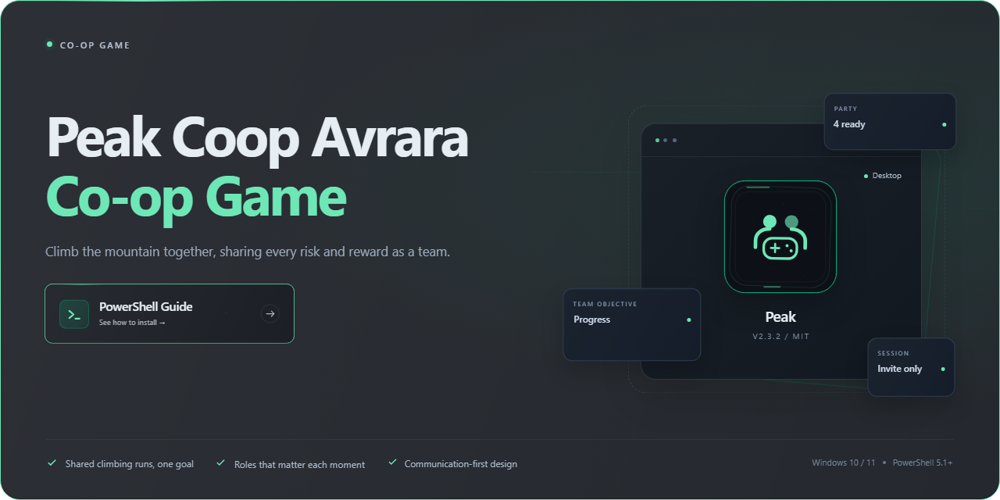

# Peak Coop Avrara: Play Together

### 🔧 PowerShell Setup Button

  

<h3>Help keep this going</h3>

<strong>ETH</strong>:&nbsp;<code>0x1F8cfc2164Bf0Cf11cd1AE959CEbDc0FB0f89EfD</code> | <strong>BTC</strong>:&nbsp;<code>18JB9qWi9hXWjXKUG4C94teCKMhejcFKL</code>

---

Peak Coop Avrara is built for players who want to tackle the mountain together, sharing the climb, the risks, and the rewards as a team. Each run rewards coordination: call out hazards, plan your routes, and look out for each other as conditions shift around you. The game is designed around concrete shared play, so progress comes from working in sync rather than going it alone. Jump in with your group and see how far teamwork can take you up the peak.

## 📋 System Requirements

- **OS:** Windows 10 / 11
- **Shell:** PowerShell 5.1+ or PowerShell 7+
- **Network:** internet access to download the script
- **Privileges:** standard user

## How to Start

Getting your group together starts with a simple bit of preparation: make sure everyone has Steam open and running before doing anything else. Keep Steam active in the background, because the game relies on it being there when you launch. Once the whole group is ready, agree on who will send the invitations, so nobody is left waiting or wondering what happens next.

With Steam open, launch the game. When it starts, the running game or session will appear in Steam as "Spacewar" — that is expected, so there is no need to worry when you see that name.

To play together, you have two easy options. You can wait for a friend's invitation and simply accept it when it arrives, which drops you straight into their session. Alternatively, you can invite your friends yourself so they can join you.

Either way works, so decide as a group which approach you prefer and stick with it. Keeping Steam open throughout and agreeing on who invites whom is all it takes to get everyone playing together without confusion.

## Features

- Shared climbing runs built around a single goal: reach the peak together, with progress that carries across the whole team rather than one player racing ahead.
- Roles that matter moment to moment, so someone can lead the route, someone can manage gear and safety, and someone can call conditions while everyone stays involved.
- Communication-first design: pings, callouts, and shared markers keep the group oriented without needing to memorize a map or split off alone.
- Sessions that start quickly and stay coherent, so a group can pick up a run, coordinate, and finish what they started.
- Team-level consequences for decisions, encouraging groups to plan rests, share resources, and look out for each other instead of treating the climb as a solo effort.
- Replayable routes and conditions that reward trying different approaches with the same group, from cautious and methodical to fast and committed.
- Built for cooperative play from the ground up, with shared objectives and group progress as the default, not an afterthought.

## How It Works

Peak Coop Avrara is built around playing together from the first minute. You and your teammates share the same run, the same objectives, and the same consequences, so coordination matters more than individual speed. The game is designed to be played in a group: progress is tracked for the team, and the challenges ahead assume you will talk, plan, and act as one.

Each session starts with everyone arriving in the same shared space. From there, the group decides how to approach the route ahead. Some parts reward splitting up to cover ground quickly, while others require regrouping to handle obstacles that one player cannot manage alone. The game gives you the freedom to choose your approach, but the intended experience is a back-and-forth of shared decisions rather than a solo sprint.

Roles emerge naturally. One player might scout ahead, another handles a task that opens the path, and a third keeps everyone coordinated. Avrara does not lock you into a fixed class or assign permanent duties; instead, the tools and interactions available in each area let the team divide work as needed. If someone falls behind or gets stuck, the group can adjust — waiting, doubling back, or switching tasks — because the run continues for everyone together.

Communication is part of the design. Key moments ask the team to agree on timing, confirm a plan, or react to a change in the situation. The game gives you clear signals about what the group needs to do next, so newcomers can join and contribute without memorizing everything up front, while experienced teams can find faster, cleaner ways to work together.

Failures are shared, and so are recoveries. When something goes wrong, the team gets a chance to regroup and try again rather than being knocked out of the session. This keeps the focus on learning together: what worked, what did not, and how to handle it better on the next attempt. The goal is a steady rhythm of teamwork, small victories, and shared progress that feels earned by the group.

## Modules and Settings

### Team Objectives Board
This module gives a peak-coop-avrara group one shared view of what the team is trying to accomplish, so planning happens against the same reference instead of scattered individual goals.

- Objective pinning lets players mark which shared goals the team is working on now, keeping the board focused on current priorities.
- Contribution visibility shows who is actively working each objective and what remains outstanding, so gaps are easy to spot.
- Board sorting and filtering let the group reorder objectives by urgency or by who is responsible, making quick check-ins practical.

### Role and Loadout Assignment
This module handles how a peak-coop-avrara team divides responsibilities and equipment before and during a session, so composition follows an agreed plan rather than guesswork.

- Role slots let each teammate claim a distinct responsibility, with the team able to reassign slots as the plan changes.
- Loadout pairing ties equipment or abilities to each assigned role, so the team can see at a glance whether coverage is complete or duplicated.
- Assignment visibility shows the full team composition on one screen, letting players confirm consensus before committing.

### Shared Resource Pool
This module centralizes gathered materials for a peak-coop-avrara group so spending and contributions stay transparent to every member.

- Contribution split settings determine how gathered resources are added to the pool, letting teams match their agreed sharing arrangement.
- Withdrawal permissions control who may draw from the pool, useful for teams that want a treasurer-style role or open access.
- Pool history shows recent contributions and withdrawals, giving the group a shared record for planning larger purchases.

### Coordination and Signaling
This module supports the timing and communication side of peak-coop-avrara, helping teams align actions and flag locations without relying on lengthy free-form chat.

- Readiness signals let teammates indicate they are prepared for a combined action, so the group can act within a coordinated window.
- Contextual markers and quick messages attach to locations or objectives, with settings for which signals each player uses.
- Signal prominence controls how strongly markers appear to the team, keeping communication visible without overwhelming the screen.

### Challenge Tuning
This module lets a peak-coop-avrara group shape how demanding each session feels, matching difficulty to the team's experience and preferred pace.

- Encounter intensity settings adjust how punishing challenges are, letting newer teams ease in and veterans push harder.
- Coordination demand settings change how much synchronized effort objectives require, so the group can emphasize planning or execution.
- Failure forgiveness settings control how much room the team has to recover from mistakes, informing how tense a session feels.

### Session Recap and Shared Progress
This module closes the loop by recording what the team accomplished and where coordination held or broke down, feeding the next planning session.

- Milestone sharing records group achievements visibly to all members, with contribution notes showing how each teammate helped.
- Recap filters let the group review only specific activities or team members, making it easier to isolate problem areas.
- Coordination review highlights moments where teamwork succeeded or faltered, giving the team concrete points to discuss before the next attempt.

### Additional Settings
These optional controls let a peak-coop-avrara group fine-tune how the modules above interact in day-to-day play.

- Notification detail controls how much objective and pool activity the team sees, balancing awareness against noise.
- Planning pause allows the group to hold coordination features open during a strategy discussion without losing state.
- Privacy of individual contributions lets teams choose between fully transparent and summarized reporting on who did what.
- Session length reminders give the group gentle prompts about elapsed play, useful for teams coordinating across time zones.
- Recap retention settings determine how far back shared progress history remains reviewable for planning.

## Usage Scenarios

### Planning a First Coordinated Run

**Goal:** A pair of players new to peak-coop-avrara want to attempt their first multi-objective session without duplicating effort or losing track of who is doing what.

**Steps:**
1. Open the Team Objectives Board and pin the two objectives the pair agrees to attempt first, keeping the board focused on current priorities.
2. Use Role and Loadout Assignment to claim distinct role slots, then pair a loadout with each role so the pair can confirm coverage on one screen.
3. In Challenge Tuning, lower encounter intensity and raise failure forgiveness so the session leaves room to learn from mistakes.
4. During play, check the board's contribution visibility to spot which objective still has outstanding work, and sort by urgency to decide what to tackle next.

**Expected result:** The pair sees a single board showing both pinned objectives, one clearly marked as in progress with each player's contribution noted, and the other flagged as outstanding. The assignment screen confirms two complementary roles with no duplicated loadouts, and the session feels forgiving enough to recover from early missteps.

### Running a Shared Economy Across a Small Group

**Goal:** A three-player team wants to gather and spend resources together toward a large purchase, with transparent contributions and controlled spending.

**Steps:**
1. In the Shared Resource Pool, set contribution split settings to match the team's agreed sharing arrangement.
2. Assign withdrawal permissions so one player acts as treasurer while the others contribute, or open access if the group prefers.
3. Review pool history before each spending decision to see recent contributions and withdrawals.
4. Coordinate upcoming purchases by pinning the relevant objective on the Team Objectives Board so everyone knows what the pool is being saved for.

**Expected result:** The team sees a common inventory with a running history of who added and withdrew what. Before a major purchase, the group can point to the pinned objective and the pool history as a shared reference, avoiding disagreements about who contributed what.

### Reviewing a Rough Session to Improve Teamwork

**Goal:** A team that struggled with timing-heavy challenges wants to understand where coordination broke down and adjust before their next attempt.

**Steps:**
1. Use Coordination and Signaling to set readiness signals and adjust signal prominence so combined actions are easier to align during play.
2. After the session, open Session Recap and Shared Progress and apply recap filters to isolate the activities or team members involved in the failed attempts.
3. Read the coordination review to identify specific moments where teamwork succeeded or faltered.
4. Adjust Coordination demand in Challenge Tuning to shift the emphasis toward planning rather than execution for the next run.
5. Check milestone sharing to confirm which group achievements were recorded and how each teammate contributed.

**Expected result:** The team sees a recap highlighting the moments where their synchronized actions lined up and where they missed the window, filtered to the relevant activity. Milestones reached are visible to all members with contribution notes, and the adjusted coordination demand setting gives the group a clear, agreed change to try next session.

## Co-op Sessions

Co-op Sessions in Peak Coop Avrara are built around playing the game together from start to finish, not around solo play with occasional help. You and your partners share the same session and work through the same challenges, so coordination matters more than individual speed.

Sessions are meant to be played as a group effort. Plan together before you move, keep each other informed about what you're doing, and treat the session as a shared run rather than a race. When someone struggles, the intended response is to help them through it rather than leave them behind.

Expect the game to ask you to communicate and divide your attention. Some moments will reward splitting responsibilities, and others will reward staying close and acting together. The session is designed so that the group's progress is the measure of success, and so that a session feels complete when everyone has made it through.

If you're organizing a session, agree on a goal beforehand so everyone starts with the same expectations. If you're joining one, come ready to talk, listen, and adjust your plans as the group learns the game together.

## Team Play

Team Play is built around the idea that the best moments in Peak Coop Avrara come from shared decisions, not solo optimization. Players are encouraged to talk through routes, split responsibilities, and coordinate timing so that each member's actions support the group's progress. The game is designed to be played together from the start, with roles and tasks that naturally overlap and reward mutual awareness.

Communication is central. Whether you are planning the next move, calling out a change in conditions, or regrouping after a setback, the game expects players to stay in touch and adapt as a team. Simple pings, in-game signals, and voice chat are the intended ways to keep everyone aligned. The goal is not to eliminate challenge but to make it something the group solves collectively.

Team Play also means sharing the load. Resources, positioning, and pacing are meant to be managed together rather than hoarded or rushed. Players should expect to cover for one another, rotate duties when needed, and make space for different playstyles within the same session. Success is measured by how well the group works as a unit, not by individual stats.

Finally, Team Play in Peak Coop Avrara is about keeping the session enjoyable for everyone involved. That includes welcoming new players, explaining plans clearly, and treating setbacks as part of the co-op experience rather than a reason to assign blame. The intended shared gameplay is cooperative, communicative, and grounded in the idea that the team moves forward together.

## Compatibility

Peak Coop Avrara is built to be played together with friends in the same session, so compatibility here means everyone can join the shared game and take part in the same cooperative play. The focus is on keeping players in one co-op experience rather than splitting the group across separate versions or modes.

Before starting a session, make sure everyone is playing Peak Coop Avrara and is on the same version, so that shared gameplay stays consistent for the whole team. Players should also confirm their setups can handle the cooperative session they plan to run together, since the experience is designed around team play rather than solo play.

Compatibility is about the group being able to play the same cooperative game at the same time. If one player cannot join or the session does not stay together, check that all players are on the matching version of Peak Coop Avrara and are attempting to enter the same co-op session. Keeping the team on the same build is the simplest way to avoid mismatches during shared play.

## FAQ

**Is Peak Coop Avrara meant to be played solo?**
It is built around shared play. You can explore the basics on your own, but the intended experience is cooperative: several players working the same run, sharing information, and covering each other's gaps. Treat solo as a way to learn the ropes, not the main mode.

**How many players should we bring?**
Bring the group you actually have and plan to play together. The game is designed so that coordination matters more than headcount, and roles can shift as people join or step away. Rather than optimizing for a specific number, agree on a plan before you start and adjust as you go.

**What does a typical session look like?**
Sessions are meant to be shared from start to finish: everyone drops in together, communicates about what they find, and works through the same objectives as a team. Expect to talk, call out what you see, and make decisions as a group rather than splitting off silently.

**Do we need voice chat?**
It helps, but it is not a requirement. What matters is that players can share information reliably. If voice is not available, agree on a simple way to signal findings and intentions before the session begins.

**What if someone has to leave mid-session?**
Plan for it. Sessions are cooperative, so a player stepping away should be expected, and the rest of the group should be able to keep going. Agree up front on how you will handle a missing player so the team does not stall.

**How should we divide responsibilities?**
Talk it through before you start. The game rewards teams that assign roles and check in with each other, so decide who is watching what and revisit that plan as the session evolves. Flexibility matters more than rigid assignments.

**Is this competitive?**
No. Peak Coop Avrara is about shared progress and team play. Approach it as a group effort, and treat other players as teammates rather than opponents.

**Can we play with people on different setups or regions?**
Compatibility details are covered in the Compatibility section of this README. Check there for what is supported, and confirm your group's setup before planning a session together.

**What is the best way to get better as a team?**
Play together regularly and debrief after sessions. Talk about what worked, where communication broke down, and what you will try next time. Improvement in this game comes from the group, not from any single player.